<div align="center">

<!-- Animated Header Banner -->
<p align="center">
  
</p>

# ⚡ Md Iftekhar
### Enterprise Cloud & DevSecOps Engineer • AI-Ops & Platform Specialist

[](https://github.com/Devops-iftekhar)
[](https://azure.microsoft.com/)
[](https://www.terraform.io/)
[](https://azure.microsoft.com/en-us/products/devops/)
[](#-next-gen-ai-ops-agentic-devops-rag--mcp)
[](#-get-in-touch--hire-me)

<p align="center">
  <b>Deploying Multi-Subscription Enterprise Landing Zones • Zero-Trust CI/CD Automation • Hybrid Cloud Migrations • Autonomous AI-Driven SRE</b>
</p>

---

[🏛️ Cloud Architecture](#-enterprise-cloud-architecture--landing-zones) •
[🛡️ DevSecOps & Pipelines](#-azure-devsecops-ci-cd--repos-governance) •
[🤖 AI-Ops & MCP Agents](#-next-gen-ai-ops-agentic-devops-rag--mcp) •
[🔒 Security Matrix](#-enterprise-defense-in-depth-security) •
[💰 FinOps & SRE](#-finops-cloud-cost-optimization--storage-sre) •
[🚀 Migration Playbook](#-enterprise-cloud-migration-framework) •
[🛠️ Tech Stack](#-technical-mastery-matrix) •
[🤝 Contact](#-get-in-touch--hire-me)

---

</div>

## 📌 Executive Profile & Mission

```bash
md-iftekhar@cloud-core:~$ whoami
Md Iftekhar — Enterprise Cloud Platform & DevSecOps Engineer

md-iftekhar@cloud-core:~$ cat mission.json
{
  "profile": "Enterprise Cloud & DevSecOps Engineer with AI-Ops Integration",
  "architectural_pillars": [
    "Scalable", "Robust", "Secure", "Reliable", "Portable",
    "Governed", "Highly Available", "Cost-Optimized", "Backed-Up", "Monitored", "Compliant"
  ],
  "hybrid_scope": "Multi-Subscription Azure Cloud, On-Premises Datacenters, Edge & Containers",
  "next_gen_edge": "Model Context Protocol (MCP) Cloud Connectors, RAG-indexed Runbooks, Agentic CI/CD Self-Healing",
  "production_standard": "100% Drift-Free IaC • Zero-Trust Identity • Immutable Auditability • CAF Compliant"
}
```

> [!NOTE]  
> **Production Mindset:** I specialize in designing and deploying enterprise platforms that bridge traditional on-premises enterprise datacenters with hyperscale Microsoft Azure environments. Every architecture is engineered from day zero to be compliant with the **Microsoft Cloud Adoption Framework (CAF)**, strictly governed through Infrastructure-as-Code (IaC), protected with **Zero-Trust DevSecOps**, and empowered with **AI-Ops and autonomous agents** for 99.99% reliability.

---

## 🏛️ Enterprise Cloud Architecture & Landing Zones

I engineer and deploy **Azure Enterprise Landing Zones (ALZ)** based on Microsoft CAF standards, orchestrating multi-tenant, multi-subscription enterprise topologies with strict separation of duties, isolated network perimeters, and centralized governance.

```
+---------------------------------------------------------------------------------------------------+
|                                     TENANT ROOT GROUP                                             |
|                               (Enterprise Policy & Access)                                        |
+-------------------------------------------------+-------------------------------------------------+
                                                  |
       +------------------------------------------+------------------------------------------+
       |                                          |                                          |
+------+---------------+                +---------+-----------+                    +---------+-----------+
|    PLATFORM MG       |                |  LANDING ZONES MG   |                    |    SANDBOX / POC    |
+------+---------------+                +---------+-----------+                    +---------------------+
       |                                          |
       +---> Management Sub                       +---> Corp Spoke Sub (Internal / ERP)
       +---> Connectivity Sub (Hub)               +---> Online Spoke Sub (Public Apps / AKS)
       +---> Identity Sub (Entra DS / DC)         +---> Data Platform Sub (Synapse / Blob)
```

<details open>
<summary><b>🌐 Deep-Dive: Hub-and-Spoke Hybrid Networking Architecture</b></summary>
<br>

```
                                  ON-PREMISES ENTERPRISE DATACENTER
                              [ Core Switch / Router: CIDR 10.0.0.0/16 ]
                                                  |
                    =============================================================
                    ||   ExpressRoute (Primary)  //  IPsec VPN Gateway (Backup)  ||
                    =============================================================
                                                  |
+-------------------------------------------------V-------------------------------------------------+
|                                    AZURE HUB VNET (CIDR: 10.100.0.0/20)                           |
|                                                                                                   |
|  +------------------------+  +--------------------------+  +-----------------------------------+  |
|  | GatewaySubnet          |  | AzureFirewallSubnet      |  | AzureBastionSubnet                |  |
|  | VPN / ER Gateways      |  | Azure Firewall Premium   |  | Secure Jump Host Zero-Public-IP   |  |
|  +------------------------+  +-------------+------------+  +-----------------------------------+  |
|                                            |                                                      |
|  +-----------------------------------------V---------------------------------------------------+  |
|  | Private DNS Zones: privatelink.blob.core.windows.net | privatelink.database.windows.net     |  |
|  | Centralized UDR (0.0.0.0/0 -> Azure Firewall Private IP) • Strict IPAM Allocation           |  |
+--------------------------------------------+------------------------------------------------------+
                                             |
                 +---------------------------+---------------------------+
                 | VNet Peering (Gateway Transit)                        | VNet Peering (Spoke-to-Hub)
                 V                                                       V
+--------------------------------+                      +--------------------------------+
|  SPOKE 1: PRODUCTION COMPUTE   |                      |  SPOKE 2: SECURE DATA PLATFORM  |
|  (CIDR: 10.100.16.0/22)        |                      |  (CIDR: 10.100.20.0/22)        |
|  • AKS Production Clusters     |                      |  • Azure SQL / Cosmos DB       |
|  • VMSS Across Availability Zs |                      |  • Azure Storage Accounts      |
|  • Ingress via App Gateway WAF |                      |  • Private Endpoints Only      |
|  • UDR to Hub Firewall         |                      |  • Public Network Access: DIS  |
+--------------------------------+                      +--------------------------------+
```

### Key Network & Architecture Deliverables:
- **Enterprise IPAM & CIDR Strategy:** Pre-allocation and assessment of non-overlapping CIDR blocks across on-premises datacenters and multi-region cloud workloads to eliminate NAT overhead and routing collisions.
- **Hub-and-Spoke with VNet Peering:** High-throughput, low-latency backbone using Azure VNet Peering with Gateway Transit enabled.
- **Perimeter Security with UDR & Azure Firewall:** Custom User Defined Routes (`0.0.0.0/0`) forcing all spoke egress traffic through centralized Azure Firewall for TLS inspection, URL filtering, and threat intelligence.
- **Zero-Public-IP PaaS Isolation:** Private Endpoints and Private Link integrated with central Private DNS Zones, ensuring database, storage, and key vault traffic never traverses the public internet.
- **Redundant Hybrid Connectivity:** ExpressRoute circuits for primary low-latency traffic backed up by automated failover to route-based VPN Gateways.

</details>

---

## 🏗️ Terraform Enterprise Landing Zone Automation & IaC

All cloud infrastructure is treated as software: fully declarative, modular, tested, versioned, and delivered through automated pipelines with continuous drift detection.

```
terraform-landing-zones/
├── environments/
│   ├── prod/             # Multi-subscription production configs
│   ├── stage/            # Pre-production staging parity
│   └── dev/              # Developer sandboxes with cost quotas
├── modules/
│   ├── networking/       # Hub, Spoke, UDR, Firewall, Private DNS, IPAM
│   ├── identity_rbac/    # Entra ID Roles, PIM, Custom RBAC definitions
│   ├── security/         # Key Vault, NSG, ASG, Defender, Policy assignments
│   ├── compute_vmss/     # Hardened VMSS, Cloud-Init, Availability Zones
│   └── storage_ha/       # ZRS/GRS Blob storage, lifecycle rules, private link
├── tests/                # Terratest automated Go integration tests
└── .tflint.hcl           # Enterprise rule sets & Azure provider linting
```

<details open>
<summary><b>⚙️ IaC Security, Remote State Governance & Drift Automation</b></summary>
<br>

| Feature | Production Implementation Standard |
| :--- | :--- |
| **Remote State Backend** | Azure Blob Storage with automated blob lease state locking to prevent concurrent apply race conditions. |
| **State Security** | Customer-Managed Keys (CMK) encryption-at-rest, TLS 1.3 in-transit, Private Endpoint access only, zero public network exposure. |
| **Access Control** | Strict RBAC using Microsoft Entra Managed Identities; zero permanent shared keys or SAS tokens stored in pipelines. |
| **Automated Linting** | `tflint` with Azure rule modules and `terraform fmt -check` enforcing standardized code style on every commit. |
| **Static Security Scanning** | `checkov` and `tfsec` gates blocking any PR violating CIS Azure Benchmarks or creating permissive NSG rules. |
| **Secret Scanning** | Pre-commit hooks and pipeline stages running `TruffleHog` to guarantee zero credentials or certificates are checked into git. |
| **Financial Costing** | Automated `Infracost` pipeline comments illustrating month-over-month delta cost before approving pull requests. |
| **Pipeline Drift Detection** | Scheduled cron pipelines running `terraform plan -detailed-exitcode` daily to detect and alert on out-of-band portal changes. |

</details>

---

## 🛡️ Azure DevSecOps CI/CD & Repos Governance

Enterprise-grade software delivery relies on immutable, repeatable, and audited CI/CD pipelines where security and quality checks are shifted left.

```
Developer Feature Branch ➔ PR Creation (Trunk-Based) ➔ Automated Quality Gates ➔ Manual Approval ➔ Deploy & Verify
        |                            |                              |                     |              |
   [Local Commit]          [Branch Policies]             [SAST/Tfsec/Infracost]     [CAB/Tech Lead]  [Rollback Guard]
```

<details open>
<summary><b>🔄 End-to-End DevSecOps Pipeline Architecture & Branching Policies</b></summary>
<br>

### 1. Trunk-Based Branching & Strict Repository Policies
- **Short-Lived Feature Branches:** Developers work on `feat/*` or `fix/*` branches merged within 24–48 hours to minimize merge debt.
- **Main Branch Protection:** Direct commits to `main` are strictly blocked.
- **No Branch Deletion:** `main` and release tags have permanent deletion protection.
- **Mandatory PR Requirements:**
  - Minimum 2 peer code reviews required.
  - Automatic assignment of **Code Owners** based on directory boundaries (`CODEOWNERS`).
  - Mandatory passing of all automated build validation checks before merge button is enabled.
  - Linear Git history enforced via Fast-Forward / Squash merge.

### 2. Multi-Stage Reusable Azure Pipeline Templates (YAML)

```yaml
# Pipeline Flow Architecture
stages:
  - stage: Validate_And_Lint
    jobs:
      - job: Code_Quality
        steps:
          - script: terraform fmt -check
          - script: tflint --init && tflint
          - script: checkov -d . --framework terraform --output junitxml

  - stage: Security_And_Cost_Scan
    jobs:
      - job: Secrets_And_Cost
        steps:
          - script: trufflehog git file://. --only-verified
          - script: infracost breakdown --path . --format json --out-file infracost.json
          - script: infracost comment github --path infracost.json --behavior update

  - stage: Build_And_Plan
    jobs:
      - job: Terraform_Plan
        steps:
          - script: terraform plan -out=tfplan.binary
          - publish: tfplan.binary

  - stage: Production_Approval_Gate
    jobs:
      - job: Manual_Approval
        pool: server
        steps:
          - task: ManualValidation@0
            inputs:
              notifyUsers: 'cloud-leads@enterprise.com'
              instructions: 'Review Infracost and Terraform Plan before authorization.'

  - stage: Apply_And_Deploy
    jobs:
      - deployment: Azure_Apply
        environment: 'Enterprise-Production'
        strategy:
          runOnce:
            deploy:
              steps:
                - script: terraform apply tfplan.binary
            on:
              failure:
                steps:
                  - script: echo "Triggering automated rollback & incident alert to Azure Monitor..."
```

### 3. Automated Middleware Setup via Custom Data & Cloud-Init
- Automated bootstrapping of Linux and Windows compute nodes via `cloud-init.yaml` and PowerShell Custom Data scripts.
- Installs telemetry agents (Azure Monitor Agent, Defender for Endpoint), configures local firewall rules, CIS benchmark system hardening, and connects nodes to target domain controllers without manual intervention.

</details>

---

## 🤖 Next-Gen AI-Ops, Agentic DevOps, RAG & MCP

Modern enterprise engineering requires blending reliable DevOps automation with cutting-edge artificial intelligence. I build **intelligent, autonomous, and self-healing cloud ecosystems** using **Model Context Protocol (MCP)**, **Retrieval-Augmented Generation (RAG)**, and **Multi-Agent Systems**.

```
+---------------------------------------------------------------------------------------------------+
|                                 NEXT-GEN AI-OPS ECOSYSTEM                                         |
+---------------------------------------------------------------------------------------------------+
       |                                          |                                          |
       V                                          V                                          V
+-----------------------+              +-----------------------+              +-----------------------+
|  MODEL CONTEXT PROTOCOL |              |     ENTERPRISE RAG     |              |   AUTONOMOUS AGENTS   |
|         (MCP)         |              |  (RUNBOOK INTELLIGENCE)|              |   (AGENTIC SRE & CI)  |
+-----------------------+              +-----------------------+              +-----------------------+
| • Azure Resource Graph|              | • Vectorized Runbooks |              | • Automated PR Review |
|   MCP Server          |              | • Cloud Incident Post-|              |   (IaC Linter & SAST) |
| • Log Analytics KQL   |              |   mortems Index       |              | • Self-Healing Canary |
|   Live Query Engine   |              | • SOPs & Compliance Q&A|              |   Rollback Agent      |
| • State File Inspector|              | • Azure OpenAI Private|              | • Anomaly Triage      |
+-----------------------+              +-----------------------+              +-----------------------+
```

<details open>
<summary><b>🧠 Production AI-Ops Implementations & Enterprise Use Cases</b></summary>
<br>

### 1. Model Context Protocol (MCP) for Cloud Infrastructure
- **Azure Infrastructure MCP Server:** Built custom MCP tools that expose live Azure Resource Graph data, Subscription hierarchies, and real-time metric streams securely to LLMs (Claude, Gemini, GPT-4) without sharing raw credentials.
- **Natural Language Incident Diagnosis:** Engineers query: *"Why did the Spoke-1 AKS cluster experience pod evictions between 02:00 and 04:00 UTC?"* ➔ The MCP agent queries Azure Monitor KQL, analyzes node memory pressure, and correlates with scheduled backup jobs.

### 2. Enterprise RAG for Cloud Operations & Runbooks
- **Automated SOP & Runbook Retrieval:** Engineered a Retrieval-Augmented Generation (RAG) system using Azure AI Search and Azure OpenAI Service to vectorize all internal architecture decision records (ADRs), disaster recovery runbooks, and compliance standards.
- **Instant Triage Guidance:** During Sev-1/Sev-2 incidents, on-call engineers receive instant, context-aware remediation steps cited directly from audited internal procedures.

### 3. Autonomous DevOps Agents & Self-Healing
- **Agentic PR Reviewer:** An AI agent integrated into Azure Repos pipelines that automatically inspects incoming Terraform code, checks against Microsoft CAF naming conventions, detects resource cost bloat, and provides inline remediation suggestions before human review.
- **Automated Drift & Remediation Agent:** In non-production environments, detected configuration drifts trigger an autonomous agent that generates a corrective pull request or reconciles state safely within defined policy limits.

### 4. Enterprise LLMOps on Azure
- Deploying and managing **Azure OpenAI Service** private instances behind Private Endpoints, implementing API Management (APIM) rate-limiting, token consumption cost attribution, and PII filtering for enterprise compliance.

</details>

---

## 🔒 Enterprise Defense-in-Depth Security

Security is embedded into every layer of the architecture, adopting a zero-trust model: **Verify Explicitly, Use Least Privilege, and Assume Breach**.

```
                           +------------------------------------------+
                           |  1. IDENTITY LEVEL (Entra ID, PIM, RBAC) |
                           +--------------------+---------------------+
                                                |
                           +--------------------V---------------------+
                           | 2. NETWORK LEVEL (FW, NSG, Private Link) |
                           +--------------------+---------------------+
                                                |
                           +--------------------V---------------------+
                           | 3. GOVERNANCE LEVEL (Policy, Defender)   |
                           +--------------------+---------------------+
                                                |
                           +--------------------V---------------------+
                           | 4. COMPUTE LEVEL (Hardened, CIS, Updates)|
                           +------------------------------------------+
```

| Security Dimension | Enterprise Implementation Controls |
| :--- | :--- |
| **🔑 Identity Level** | • Microsoft Entra ID (Azure AD) with Zero-Trust principles.<br>• **Privileged Identity Management (PIM):** Just-in-Time (JIT) role elevation with mandatory MFA and ticket justification.<br>• **Managed Identities:** System-Assigned identities for VMs, App Services, and Pipelines; elimination of static service principal secrets.<br>• **Conditional Access Policies:** Strict device compliance, geolocation restrictions, and session risk analysis. |
| **🌐 Network Level** | • Micro-segmentation with Network Security Groups (NSGs) & Application Security Groups (ASGs).<br>• Centralized Azure Firewall Premium with TLS inspection and IDPS (Intrusion Detection/Prevention).<br>• Forced tunneling (`0.0.0.0/0`) eliminating direct outbound internet access from compute spokes.<br>• DDoS Protection Standard enabled across public IP resources.<br>• PaaS access locked down exclusively via Private Endpoints. |
| **📜 Governance Level** | • **Azure Policy Enforcement:** Automated Deny policies blocking creation of public IPs, unencrypted disks, and unapproved VM sizes.<br>• Mandatory cost-center and owner tagging enforced at subscription and resource group scopes.<br>• **Microsoft Defender for Cloud:** Continuous CSPM (Cloud Security Posture Management) and CWPP (Cloud Workload Protection). |
| **💻 Compute Level** | • Golden VM images built using Packer hardened against **CIS Azure Benchmark Level 2**.<br>• Azure Update Management Center executing automated vulnerability patching schedules.<br>• Disk encryption using Customer-Managed Keys (CMK) stored in Azure Key Vault Premium with HSM backing.<br>• Ephemeral OS disks for stateless workloads to maximize security and minimize disk I/O cost. |

---

## 💰 FinOps, Cloud Cost Optimization & Storage SRE

Cloud infrastructure must deliver business value without runaway expenditures. I implement full-lifecycle **FinOps (Inform, Optimize, Operate)** and rigorous Site Reliability Engineering (SRE) disaster recovery standards.

<details open>
<summary><b>💵 FinOps Framework & Cost Optimization Tactics</b></summary>
<br>

```
FINOPS LIFECYCLE:
  [ 1. INFORM ]   --> Real-time visibility, cost-center chargebacks, showbacks, tag hygiene
  [ 2. OPTIMIZE ] --> Zombie asset pruning, right-sizing compute, commitment discounts (RIs)
  [ 3. OPERATE ]  --> Continuous governance, automated shutdown schedules, telemetry cost tuning
```

- **Zombie Resource Culling:** Automated scripts identifying and purging orphaned unattached Managed Disks, unused Public IPs, idle Application Gateways, and empty Elastic Pools.
- **Compute Right-Sizing:** Auditing CPU and Memory P95 utilization over 30-day windows; rightsizing over-provisioned instances to match actual workload demand.
- **Telemetry & Log Ingestion Optimization:** Fine-tuning Azure Monitor & Log Analytics tables; eliminating verbose debug event logs and setting table-level data retention to reduce ingestion billing by up to **40%**.
- **Scheduled Power Management:** Automated start/stop runbooks using Azure Functions and Automation Accounts for non-production environments during nights and weekends.
- **Reserved Instances & Savings Plans:** Financial modeling and procurement of 1-Year and 3-Year Azure Reserved VM Instances (RIs) and Azure Compute Savings Plans, unlocking up to **72% savings**.
- **Backup & Storage Lifecycle:** Transitioning storage blobs automatically across tiers (`Hot` ➔ `Cool` ➔ `Cold` ➔ `Archive`) and tuning backup retention windows (RPO-aligned) to prevent unbounded storage growth.

</details>

<details open>
<summary><b>💾 Storage Redundancy, High Availability & Disaster Recovery (SRE)</b></summary>
<br>

| Redundancy Type | SLA Durability | Target Scenario & RTO / RPO |
| :---: | :---: | :--- |
| **LRS** (Locally Redundant) | 99.999999999% (11 9's) | Development, temporary scratch data, stateless workloads within a single facility. |
| **ZRS** (Zone-Redundant) | 99.9999999999% (12 9's) | Mission-critical Tier-1 apps resilient against entire datacenter failure within a region. |
| **GRS / RA-GRS** (Geo-Redundant) | 99.99999999999999% (16 9's) | Enterprise compliance, DR replication to paired secondary regions with read-access failover. |

- **Virtual Machine Scale Sets (VMSS):** Auto-scaling compute clusters distributed across 3 distinct Availability Zones with health probes and automatic instance repair.
- **Disaster Recovery Strategy:**
  - **RTO (Recovery Time Objective):** `< 15 Minutes` for mission-critical core application stacks.
  - **RPO (Recovery Point Objective):** `< 5 Minutes` data loss window using synchronous database replication.
  - **Azure Site Recovery (ASR):** Automated orchestration and non-disruptive disaster recovery testing between Primary and Secondary Azure Paired Regions.

</details>

---

## 🚀 Enterprise Cloud Migration Framework

A battle-tested migration framework based on the **6-R Strategy** to migrate legacy on-premises physical servers, VMware/Hyper-V clusters, and databases into Azure with near-zero downtime.

```
+---------------------------------------------------------------------------------------------------+
|                                 6-R MIGRATION LIFECYCLE                                           |
+---------------------------------------------------------------------------------------------------+
  1. DISCOVERY & ASSESSMENT  -->  2. PLANNING & WAVE DESIGN  -->  3. CUTOVER & HYPERCARE
  • Azure Migrate Appliance       • 6-R Strategy Assignment       • Rehearsal Drills
  • TCO & Readiness Analysis      • Wave Bundling (Dependencies)  • Cutover Execution Window
  • Dependency Mapping            • Landing Zone Pre-provisioning • 24/7 Hypercare & Tuning
```

<details>
<summary><b>📋 Comprehensive Migration Checklists (Pre, During, and Post-Cutover)</b></summary>
<br>

### 1. Pre-Migration Checklist
- [x] Deploy Azure Migrate appliance in on-premises VMware / Hyper-V cluster.
- [x] Complete hardware discovery, software inventory, and network dependency mapping.
- [x] Execute TCO (Total Cost of Ownership) and Azure Readiness assessments.
- [x] Verify target Hub-and-Spoke network CIDR availability and firewall routing paths.
- [x] Establish Azure ExpressRoute / Site-to-Site VPN connectivity with verified throughput.
- [x] Define migration strategy for each workload:
  - **Rehost (Lift & Shift):** ASR replication for legacy stateful VMs.
  - **Replatform:** Transitioning SQL Server to Azure SQL Managed Instance (MI).
  - **Refactor:** Containerizing monolithic services into Azure Kubernetes Service (AKS).
  - **Retain / Retire / Repurchase:** Decommissioning zombie on-premises apps or adopting SaaS.
- [x] Conduct non-disruptive test failovers in isolated sandbox networks.

### 2. During-Cutover Checklist
- [x] Initiate change management cutover window and notify stakeholder bridge.
- [x] Lower DNS Record TTL (Time-To-Live) to 300 seconds prior to cutover.
- [x] Place source on-premises databases into read-only mode for final delta synchronization.
- [x] Execute final delta sync via Azure Site Recovery / Database Migration Service (DMS).
- [x] Spin up production target workloads in Azure Spoke VNets and verify healthy state.
- [x] Switch DNS routing to point to Azure Application Gateway / Azure Front Door.
- [x] Execute automated smoke tests verifying database connectivity, auth, and API health.

### 3. Post-Migration & Hypercare Checklist
- [x] Enter **Hypercare Window (7–14 days)** with 24/7 monitoring and telemetry triage.
- [x] Verify Azure Monitor Agent data ingestion, Log Analytics dashboards, and alert triggers.
- [x] Validate Azure Backup snapshot generation and test automated restore capability.
- [x] Review initial cost patterns in Microsoft Cost Management; apply rightsizing adjustments.
- [x] Power down source on-premises virtual machines; maintain 30-day retention before decommission.

</details>

---

## 📊 Enterprise Observability, SRE & KQL Analytics

You cannot manage what you do not measure. I build single-pane-of-glass observability ecosystems combining **Azure Monitor**, **Log Analytics Workspaces**, **Application Insights**, and custom **Kusto Query Language (KQL)** analytics.

<details open>
<summary><b>📈 High-Value KQL Operational Queries & SRE Dashboards</b></summary>
<br>

#### 1. Security: Detecting High-Risk Failed Sign-Ins & Anomalous IP Access
```kusto
SigninLogs
| where TimeGenerated > ago(24h)
| where ResultType != 0 // Failed authentication
| summarize FailedCount = count(), UniqueUsers = dcount(UserPrincipalName) by IPAddress, Location
| where FailedCount > 20
| order by FailedCount desc
```

#### 2. FinOps: Identifying Consistently Idle / Underutilized Virtual Machines
```kusto
Perf
| where TimeGenerated > ago(7d)
| where ObjectName == "Processor" and CounterName == "% Processor Time"
| summarize AvgCPU = avg(CounterValue), MaxCPU = max(CounterValue) by Computer
| where AvgCPU < 5 and MaxCPU < 15
| project Computer, AvgCPU, MaxCPU, Recommendation = "Candidate for Rightsizing or Deallocation"
```

#### 3. SRE: Correlating Application HTTP 5xx Outages with Latency
```kusto
AppRequests
| where TimeGenerated > ago(4h)
| summarize TotalRequests = count(), 
            Errors = countif(ResultCode startswith "5"), 
            AvgDurationMs = avg(DurationMs) 
            by bin(TimeGenerated, 5m), OperationName
| extend ErrorRate = (todouble(Errors) / todouble(TotalRequests)) * 100
| where ErrorRate > 2.0
| order by TimeGenerated desc
```

</details>

---

## 🛠️ Technical Mastery Matrix

<div align="center">

| Domain | Technologies & Frameworks |
| :--- | :--- |
| **☁️ Cloud Platforms** | **Microsoft Azure** (Landing Zones, Multi-Subscription, CAF, Azure Virtual WAN, Hybrid Cloud), On-Premises Datacenters |
| **🛡️ Infrastructure as Code** | **Terraform Enterprise**, Azure Bicep, ARM Templates, Terratest, TFLint, Checkov, Infracost |
| **🔄 CI/CD & DevSecOps** | **Azure DevOps Pipelines**, GitHub Actions, YAML Multistage Pipelines, GitOps, TruffleHog, SonarQube |
| **🤖 AI-Ops & Modern AI** | **Model Context Protocol (MCP)**, **Retrieval-Augmented Generation (RAG)**, Multi-Agent AI SRE, Azure OpenAI Service, LangChain |
| **🐳 Containers & Orchestration** | **Kubernetes (AKS)**, Docker, Helm, Ingress NGINX, Azure Container Registry (ACR), Cilium CNI |
| **🔐 Identity & Governance** | **Microsoft Entra ID (Azure AD)**, PIM, RBAC, Azure Policy, Defender for Cloud, Key Vault, Zero-Trust |
| **🌐 Enterprise Networking** | **Hub-and-Spoke**, Azure Firewall Premium, UDR, ExpressRoute, VPN Gateway, Private Link, Private DNS |
| **📈 Observability & SRE** | **Azure Monitor**, Log Analytics, Application Insights, **KQL (Kusto)**, Prometheus, Grafana, Action Groups |
| **💰 FinOps & Migrations** | **FinOps Framework**, Azure Migrate, Azure Site Recovery (ASR), Reserved Instances, Cost Management |
| **📜 Scripting & Systems** | **PowerShell 7 Core**, Bash, Python, Linux (Ubuntu, RHEL), Windows Server, Cloud-Init |

</div>

<br>

<div align="center">

<!-- Tech Badges -->


</div>

---

## 📈 GitHub Activity & Engineering Metrics

<div align="center">

<p align="center">
  
  
</p>

<p align="center">
  
</p>

</div>

---

## 🤝 Get In Touch • Let's Build Resilient Platforms

I am actively open to **Enterprise DevOps Engineer**, **Cloud & DevSecOps Engineer**, **DevSecOps Specialist**, and **Platform Engineering** roles where I can engineer and maintain scalable, secure, and cost-efficient cloud foundations.

<div align="center">

[](https://www.linkedin.com)
[](https://github.com/Devops-iftekhar)
[](mailto:contact@enterprise-cloud.io)
[](#-get-in-touch--hire-me)

<br>

```
"Engineering resilient cloud foundations where security is continuous, infrastructure is code, 
and artificial intelligence elevates operational excellence."
```

<p align="center">
  <b>Designed with ❤️ and built for Enterprise Scale • © Md Iftekhar</b>
</p>

</div>
